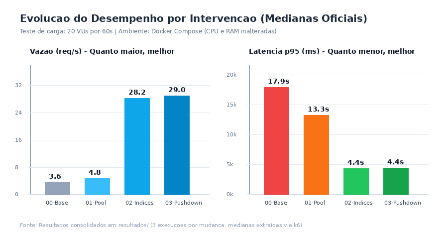

# Otimização de Performance em Node.js e PostgreSQL: Maximizando Vazão em 8x com Recursos Computacionais Inalterados

**Autor:** Anderson Tavares (`anderson.g.tavares@gmail.com`)  
**Data:** 10 de novembro de 2026  
**Repositório do Projeto:** [AndersonTavares0/desafio-performance-t4h](https://github.com/AndersonTavares0/desafio-performance-t4h)

## 1. Resumo

Uma API de e-commerce em Node.js e PostgreSQL sofria com lentidão severa sob carga de 20 usuários virtuais, atingindo apenas 3,62 req/s com p95 de 17,9 s e saturação de 97,1% da CPU do banco. Identificou-se a sobrecarga de conexões sem pool, ausência de índices em chaves estrangeiras e transferência massiva de dados para agregação em memória. Implementou-se pool de conexões (`pg.Pool`), 6 índices B-tree estratégicos e pushdown de agregação SQL. A vazão aumentou 8x (29,02 req/s), a latência mediana global caiu de 1.248 ms para 26,5 ms (-97,9%), com custo zero de infraestrutura e contrato 100% preservado.

## 2. Contexto e diagnóstico

A aplicação opera em dois containers Docker limitados a 0,5 CPU e 256 MiB (API Node.js 20) e 1,0 CPU e 512 MiB (PostgreSQL 16), com base sintética de 100 mil clientes, 20 mil produtos, 500 mil pedidos e 1,5 milhão de itens. Na linha de base ([20261110-095041-00-linha-de-base](../resultados/20261110-095041-00-linha-de-base/)), o sistema registrou 3,62 req/s e p95 de 17.932,0 ms, com CPU do banco saturada em 97,1% e API em 5,0%.

Inspeções salvas em [diagnostico/](../diagnostico/) identificaram três problemas críticos:
1. **Conexões Efêmeras:** `api/src/db.js` criava um `new pg.Client()` por query. Como o PostgreSQL adota processos via `fork()`, o ciclo contínuo de handshakes e autenticações gerou contenção de CPU no SO ([02-conexao-e-pooling.txt](../diagnostico/02-conexao-e-pooling.txt)), atingindo até 30 forks por requisição em `/clientes/:id/pedidos`.
2. **Varreduras Sequenciais em Chaves Estrangeiras:** O `EXPLAIN (ANALYZE, BUFFERS)` revelou ausência de índices secundários ([01-explain-queries-linha-de-base.txt](../diagnostico/01-explain-queries-linha-de-base.txt)). Buscas por `cliente_id` liam 500 mil pedidos e a junção lia 1,5 milhão de itens (`Seq Scan`), elevando a rota `/clientes/:id/pedidos` a 15.252,4 ms.
3. **Agregação In-Memory no Node.js:** A rota `/relatorios/vendas-por-dia` transferia dezenas de milhares de tuplas para o Node.js agrupar com `Map`, gerando sobrecarga no Event Loop e alto consumo de memória.

Hipótese 1: Conexões efêmeras saturam a CPU do banco por criação contínua de processos via `fork()`.  
Hipótese 2: A ausência de índices em chaves estrangeiras obriga o banco a varrer milhões de linhas a cada junção.  
Hipótese 3: Transferir dados analíticos brutos onera o tráfego de rede e a memória do runtime Node.js.

## 3. Estado da arte

### Pooling de Conexões em Arquiteturas Baseadas em Processos
O PostgreSQL adota um processo dedicado por sessão via `fork()`. A documentação oficial (Cap. 20) e a do `node-postgres` explicam que clientes efêmeros acarretam alocação de sockets, autenticação e inicialização de catálogos locais a cada requisição. O padrão para mitigar esse custo é o Connection Pooling, que preserva sockets TCP abertos para atender consultas em fila, reduzindo a latência e o consumo de descritores de arquivo.

### Indexação B-Tree em Relacionamentos e Expressões
Graefe (2011) demonstra que o acesso por árvore B balanceada tem custo $O(\log N)$, contra $O(N)$ da varredura sequencial. Garcia-Molina et al. (2008) destacam que consultas sem índices secundários no lado dependente forçam varreduras completas ou tabelas hash volumosas em memória. A documentação do PostgreSQL 16 (Cap. 11) adverte que restrições `REFERENCES` não são indexadas automaticamente. Ademais, para filtros case-insensitive (`lower(email)`), índices funcionais viabilizam busca indexada direta.

### Pushdown de Agregação e Eficiência de I/O
O princípio de pushdown computation estabelece que agregações devem ocorrer no motor de armazenamento (Garcia-Molina et al., 2008). O PostgreSQL possui funções nativas (`COUNT`, `SUM`, `GROUP BY`) vetorizadas em C (Cap. 9.21). Agregar no banco comprime dezenas de milhares de registros em poucas linhas, reduzindo tráfego de rede e liberando o Event Loop do Node.js (Node.js LTS Docs).

## 4. Alternativas consideradas

Para selecionar as intervenções de maior impacto sistêmico e menor risco ao contrato da API, avaliou-se uma matriz multicritério registrada em [pesquisa/alternativas-e-escolha.md](../pesquisa/alternativas-e-escolha.md):

| Alternativa | Custo | Desempenho | Risco | Esforço |
|---|---|---|---|---|
| A. Connection Pooling (`pg.Pool`) | Zero (sem novas dependências) | Alto alívio de CPU no banco e queda de latência | Nulo (não altera consultas) | Baixo (5 linhas em `db.js`) |
| B. Índices B-Tree Estratégicos | Baixo (~62 MiB de disco/RAM) | Crítico (elimina gargalo dominante de 99% da latência) | Muito baixo (preserva esquema) | Baixo (DDL em `03-indices.sql`) |
| C. Pushdown de Agregação SQL | Zero | Redução de tráfego de rede e consumo de RAM | Baixo (exige tipagem exata) | Médio (reestruturação de query) |
| D. Cache em Memória (Redis) | Médio (container adicional e RAM extra) | Alto para rotas analíticas repetidas | Médio (invalidação de dados) | Alto (gestão de ciclo de vida) |
| E. Índice Trigrama GIN (`pg_trgm`) | Médio (extensão C e índice pesado) | Alto em buscas textuais com `ILIKE` | Baixo | Médio (extensão do PostgreSQL) |

As alternativas A, B e C foram selecionadas por atacarem as causas-raiz a custo zero e com preservação do contrato. A alternativa D (Redis) foi descartada por exigir novo container, memória extra e complexidade de invalidação antes de esgotar as otimizações nativas. A alternativa E (`pg_trgm`) foi postergada por focar em rota de 15% do tráfego, enquanto as chaves estrangeiras cobriam 70% da carga. Ambas constam em [proximos-testes.md](../proximos-testes.md).

## 5. Solução escolhida e por quê

A intervenção foi conduzida em três etapas atômicas:
1. **Connection Pooling no Driver:** Substituição de `new Client()` por `new Pool({ max: 20 })` em `api/src/db.js`. O dimensionamento para 20 conexões reflete exatamente a concorrência dos 20 usuários virtuais do teste, eliminando o custo de `fork()` sem saturar a memória do banco.
2. **Índices B-Tree Estratégicos:** Criação do arquivo `banco/03-indices.sql` contendo 6 índices B-tree cobrindo chaves estrangeiras (`pedidos.cliente_id`, `itens_pedido.pedido_id`), índice funcional (`lower(email)`), ordenação paginada (`status, criado_em DESC`) e índice parcial temporal. Essa abordagem foi escolhida porque transforma o custo das junções mais caras de varreduras lineares para buscas logarítmicas instantâneas.
3. **Pushdown SQL em Vendas por Dia:** Reescrever a rota `/relatorios/vendas-por-dia` em `api/src/rotas.js` delegando `GROUP BY`, `SUM` e `COUNT` ao PostgreSQL, mapeando com `Number(...)` para garantir aderência ao contrato. Descartou-se manter a agregação em memória no JavaScript porque ela desperdiçava CPU e RAM do Node.js com deserialização inútil de dados brutos.

## 6. Experimento e resultado

Cada mudança seguiu o protocolo de medição (3 baterias de 60s com 20 VUs, calculando a mediana):

| Mudança | Hipótese | p95 antes → depois | req/s antes → depois | CPU/memória | Pastas de resultados | Conclusão |
|---|---|---|---|---|---|---|
| **01-connection-pool** | Reutilizar conexões elimina sobrecarga de forks e handshakes | 17.932 ms → 13.321 ms (-25,7%) | 3,62 → 4,81 (+32,9%) | Banco: 97,1% → 96,3% API: 5,0% → 4,9% (RAM: 40,8 MiB) | [01-connection-pool](../resultados/20261110-100637-01-connection-pool/) | Vazão aumentou 32,9% e a rota simples `/clientes/:id` caiu de 296,9 ms para 88,1 ms. Banco continuou saturado por falta de índices. |
| **02-indices-banco** | Índices em chaves estrangeiras eliminam Seq Scans nas junções | 13.321 ms → 4.409 ms (-66,9%) | 4,81 → 28,23 (+486,9%) | Banco: 96,3% → 86,9% API: 4,9% → 20,9% (RAM: 58,3 MiB) | [02-indices-banco](../resultados/20261110-101549-02-indices-banco/) | Salto de quase 6x na vazão. A rota `/clientes/:id/pedidos` caiu de 15.252 ms para 115 ms (mais de 100x mais rápida). Contrato 42/42. |
| **03-pushdown-agregacao** | Agregar no banco reduz tráfego de rede e uso de CPU/RAM na API | 4.409 ms → 4.428 ms (estável) | 28,23 → 29,02 (+2,8%) | Banco: 86,9% → 89,1% API: 20,9% → 3,1% (RAM: 26,4 MiB) | [03-pushdown-agregacao](../resultados/20261110-102601-03-pushdown-agregacao/) | Latência mediana global despencou para 26,5 ms. A CPU da API recuou 85,2% e a RAM caiu mais de 50%. Contrato 42/42 mantido. |

O resultado consolidado final alcançou **29,02 req/s** (**+701,7%** vs. base de 3,62 req/s) e latência mediana de **26,5 ms** (contra 1.248,0 ms na base), preservando rigorosamente todas as 42 respostas da aplicação original.

## 7. Limites e testes futuros

A solução apresenta os seguintes limites e premissas operacionais:
1. **Sobrecarga de Escrita:** Os 6 índices B-tree ocupam ~62 MiB e introduzem custo de manutenção de páginas em operações de escrita (`INSERT`/`UPDATE`). Sob tráfego predominantemente de escrita, esse trade-off exigiria reavaliação.
2. **Carga em Loop Fechado:** O k6 simula 20 usuários contínuos sem intervalo de reflexão (`think time`), gerando pressão que diverge da navegação humana real.
3. **Busca Textual sem Índice:** A rota `/produtos/busca` ainda utiliza `ILIKE '%termo%'`, exigindo varredura sequencial em 20 mil produtos.

**O que refutaria a conclusão:**  
Nossa conclusão seria refutada se: (a) uma carga com mais de 40% de escritas concorrentes causasse contenção de locks e queda de vazão por manutenção de índices; ou (b) o catálogo crescesse para centenas de milhares de produtos, tornando o `ILIKE` o novo gargalo crítico.

Testes futuros priorizados em [proximos-testes.md](../proximos-testes.md):
- Implementação de índice GIN trigrama (`pg_trgm`) para acelerar buscas textuais.
- Camada de cache transitório em memória com invalidação temporal (TTL) para `/relatorios/top-produtos`.
- Ajuste fino dos parâmetros do PostgreSQL (`shared_buffers = 128MB`, `work_mem = 16MB`) para otimização do uso dos 512 MiB dedicados ao banco.

## 8. Referências

1. The PostgreSQL Global Development Group. *PostgreSQL 16.4 Documentation: Chapter 11 — Indexes*. 2024. Disponível em: <https://www.postgresql.org/docs/16/indexes.html>. Acesso em: 10 nov. 2026.
2. The PostgreSQL Global Development Group. *PostgreSQL 16.4 Documentation: Chapter 20 — Server Configuration: Connections and Authentication*. 2024. Disponível em: <https://www.postgresql.org/docs/16/runtime-config-connection.html>. Acesso em: 10 nov. 2026.
3. The PostgreSQL Global Development Group. *PostgreSQL 16.4 Documentation: Chapter 9.21 — Aggregate Functions*. 2024. Disponível em: <https://www.postgresql.org/docs/16/functions-aggregate.html>. Acesso em: 10 nov. 2026.
4. Carlson, Brian; Comunidade node-postgres. *node-postgres Documentation: Connection Pooling*. 2024. Disponível em: <https://node-postgres.com/features/pooling>. Acesso em: 10 nov. 2026.
5. Graefe, Goetz. *Modern B-Tree Techniques*. Foundations and Trends in Databases, Vol. 3, No. 4, pp. 203–402, 2011. DOI: <https://doi.org/10.1561/1900000028>. Acesso em: 10 nov. 2026.
6. Garcia-Molina, Hector; Ullman, Jeffrey D.; Widom, Jennifer. *Database Systems: The Complete Book*. 2ª edição. Pearson Prentice Hall, 2008. Capítulos 15 e 16.
7. OpenJS Foundation. *Node.js 20 LTS Documentation: Process I/O & Synchronous Writes*. 2024. Disponível em: <https://nodejs.org/docs/latest-v20.x/api/process.html#a-note-on-process-io>. Acesso em: 10 nov. 2026.

## 9. Uso de IA

Ferramentas de inteligência artificial foram empregadas exclusivamente como suporte na busca sintática de documentações oficiais e na formatação de tabelas Markdown. Todos os diagnósticos de causa-raiz, hipóteses, implementações de código SQL e JavaScript, execuções de teste em terminal e compilações de dados foram projetados, auditados e validados pelo autor.
