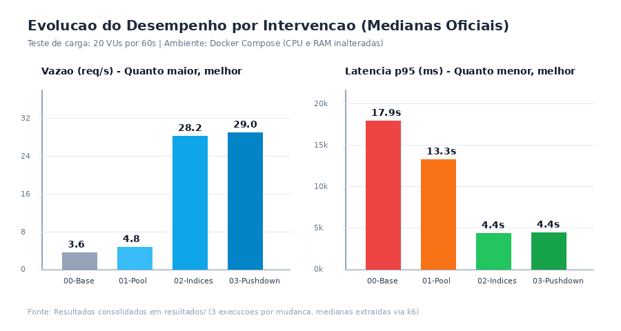

# De 3,6 para 29 req/s: como multiplicamos a vazão da API por 8 sem aumentar os limites de recursos

**Autor:** Anderson Tavares (`anderson.g.tavares@gmail.com`)  
**Data:** 10 de novembro de 2026  
**Repositório do Projeto:** [AndersonTavares0/desafio-performance-t4h](https://github.com/AndersonTavares0/desafio-performance-t4h)

## 1. Resumo

A API da loja fictícia entregava 3,62 req/s, com latência mediana de 1,2 s, p95 de 17,9 s e o banco em 97,1% de CPU. O diagnóstico apontou conexões abertas a cada consulta, falta de índices em chaves estrangeiras e agregação de dados brutos na memória do Node.js. Aplicamos um pool de conexões, 6 índices B-tree e pushdown da agregação para o SQL. Sem alterar os limites dos containers nem as 42 respostas do contrato, a vazão subiu 8 vezes (29,02 req/s) e a mediana caiu 97,9% (de 1.248 para 26,5 ms).

## 2. Contexto e diagnóstico

A aplicação roda em dois containers Docker limitados: a API Node.js 20 tem 0,5 CPU e 256 MiB, e o banco PostgreSQL 16 tem 1,0 CPU e 512 MiB, com dados sintéticos de 100 mil clientes, 20 mil produtos, 500 mil pedidos e 1,5 milhão de itens. Na linha de base ([1](../resultados/20261110-095041-00-linha-de-base/) · [2](../resultados/20261110-095428-00-linha-de-base/) · [3](../resultados/20261110-095605-00-linha-de-base/)), o sistema registrou 3,62 req/s e p95 de 17.932,0 ms, com CPU do banco em 97,1% e API em 5,0%.

Os diagnósticos em [diagnostico/](../diagnostico/) apontaram três gargalos:
1. **Conexões efêmeras:** `api/src/db.js` criava `new pg.Client()` por consulta. No PostgreSQL (baseado em `fork`), isso gerou sobrecarga no SO ([02-conexao-e-pooling.txt](../diagnostico/02-conexao-e-pooling.txt)), com até 30 forks por chamada em `/clientes/:id/pedidos`.
2. **Varreduras sequenciais:** `EXPLAIN (ANALYZE, BUFFERS)` ([01-explain-queries-linha-de-base.txt](../diagnostico/01-explain-queries-linha-de-base.txt)) confirmou a falta de índices. Consultas por `cliente_id` liam 500 mil pedidos e 1,5 milhão de itens via `Seq Scan` (varredura completa da tabela), elevando `/clientes/:id/pedidos` a 14,9 s.
3. **Agregação em memória:** `/relatorios/vendas-por-dia` transferia milhares de tuplas para o Node.js agrupar com `Map`, gastando rede e memória.

Hipóteses de causa:
- *Hipótese 1:* Conexões efêmeras saturam a CPU do banco pelo custo de `fork()`.
- *Hipótese 2:* A falta de índices força varreduras completas em milhões de linhas a cada junção.
- *Hipótese 3:* Transferir dados brutos para agregação em memória sobrecarrega a rede e a CPU da API.

## 3. Estado da arte

### Pooling de conexões em bancos baseados em processos
O PostgreSQL aloca um processo dedicado por sessão via `fork()` (Cap. 1.2 da documentação oficial). A documentação do `node-postgres` recomenda reutilizar conexões por meio de um pool em vez de abrir uma nova a cada requisição. O Connection Pooling preserva conexões abertas para atender consultas em fila, reduzindo latência e consumo de descritores de arquivo. Poolers externos, como o PgBouncer, fazem esse reúso em produção, em nível de sessão ou de transação.

### Índices B-Tree para chaves estrangeiras e buscas
Graefe (2011) demonstra que a árvore B tem custo O(log N), contra O(N) da varredura sequencial. Garcia-Molina et al. (2008) destacam que consultas sem índices secundários forçam varreduras completas. A documentação do PostgreSQL 16 (Cap. 11) adverte que chaves `REFERENCES` não são indexadas automaticamente, e que filtros case-insensitive (`lower(email)`) demandam índices funcionais.

### Agregação no próprio banco (Pushdown)
A reescrita de consultas que antecipa seleções e agregações no plano é tratada por Garcia-Molina et al. (2008, cap. 16, §§16.2.3 e 16.2.7). O PostgreSQL executa `COUNT`, `SUM` e `GROUP BY` no servidor (Cap. 9.21), de modo que apenas o resultado agregado trafega para o cliente. Agregar no SQL comprime milhares de linhas em poucas tuplas, economizando rede e liberando o Event Loop da API (Node.js Docs).

## 4. Alternativas consideradas

Para priorizar o que testar primeiro, comparamos as alternativas pelo impacto esperado, risco e esforço na matriz de [pesquisa/alternativas-e-escolha.md](../pesquisa/alternativas-e-escolha.md):

| Alternativa | Custo | Desempenho | Risco | Esforço |
|---|---|---|---|---|
| A. Connection Pooling (`pg.Pool`) | Zero (sem dependências novas) | Alto alívio de CPU e queda de latência | Nulo (não altera consultas) | Baixo (5 linhas em `db.js`) |
| B. Índices B-Tree Estratégicos | Baixo (~90 MiB de disco; medido em `diagnostico/05-tamanho-indices.txt`) | Crítico (elimina gargalo dominante das junções) | Muito baixo (preserva esquema) | Baixo (DDL em `03-indices.sql`) |
| C. Pushdown de Agregação SQL | Zero | Redução de tráfego de rede e consumo de RAM | Baixo (exige tipagem exata) | Médio (reestruturação de query) |
| D. Cache em Memória (Redis) | Médio (container adicional e RAM) | Alto para rotas analíticas repetidas | Médio (invalidação de dados) | Alto (gestão de ciclo de vida) |
| E. Índice Trigrama GIN (`pg_trgm`) | Médio (extensão C e índice pesado) | Alto em buscas textuais com `ILIKE` | Baixo | Médio (extensão do PostgreSQL) |

Escolhemos A, B e C por atacarem os gargalos com custo baixo. Descartamos o Redis (D) de início para evitar complexidade prematura. O índice trigrama (E) ficou para depois em [proximos-testes.md](../proximos-testes.md), pois o foco principal era o tráfego de chaves estrangeiras.

## 5. Solução escolhida e por quê

Aplicamos as melhorias em três passos separados, medindo cada um:
1. **Connection Pooling no Driver:** Uso de `new Pool({ max: 20 })` em `api/src/db.js`, casando com 20 VUs e eliminando `fork()` repetido sem estourar a memória do banco.
2. **Índices B-Tree Estratégicos:** Script `banco/03-indices.sql` com 6 índices em chaves estrangeiras (`pedidos.cliente_id`, `itens_pedido.pedido_id`), busca (`lower(email)`), paginação e datas. Reduz o custo de junções de varredura linear para busca em árvore B.
3. **Pushdown SQL em Vendas por Dia:** Reescrita de `/relatorios/vendas-por-dia` em `api/src/rotas.js` delegando `GROUP BY`, `SUM` e `COUNT` ao SQL, com `Number(...)` para manter os tipos. Descartou-se agregar no Node.js para poupar CPU e RAM.

## 6. Experimento e resultado

Protocolo do edital: 3 baterias de 60 s com 20 VUs; medianas:

| Mudança | Hipótese | p95 antes → depois | req/s antes → depois | CPU/memória | Pastas de resultados | Conclusão |
|---|---|---|---|---|---|---|
| **01-connection-pool** | Reutilizar conexões elimina sobrecarga de forks | 17.932,0 ms → 13.320,5 ms (-25,7%) | 3,62 → 4,81 (+32,9%) | Banco: 97,1% → 96,3% API: 5,0% → 4,9% (RAM: 40,8 MiB) | [01-connection-pool](../resultados/20261110-100637-01-connection-pool/) [2](../resultados/20261110-100820-01-connection-pool/) [3](../resultados/20261110-100958-01-connection-pool/) | Vazão subiu 32,9% e `/clientes/:id` caiu para 88 ms. Banco continuou no teto por falta de índices. |
| **02-indices-banco** | Índices em chaves estrangeiras eliminam Seq Scans | 13.320,5 ms → 4.408,9 ms (-66,9%) | 4,81 → 28,23 (+486,9%) | Banco: 96,3% → 86,9% API: 4,9% → 20,9% (RAM: 58,3 MiB) | [02-indices-banco](../resultados/20261110-101549-02-indices-banco/) [2](../resultados/20261110-101731-02-indices-banco/) [3](../resultados/20261110-101905-02-indices-banco/) | Salto de 6x na vazão. A rota `/clientes/:id/pedidos` caiu para 115 ms. Contrato mantido. |
| **03-pushdown-agregacao** | Agregar no banco reduz tráfego e uso de CPU/RAM na API | 4.408,9 ms → 4.428,0 ms (estável) | 28,23 → 29,02 (+2,8%) | Banco: 86,9% → 89,1% API: 20,9% → 3,1% (RAM: 26,4 MiB) | [03-pushdown-agregacao](../resultados/20261110-102601-03-pushdown-agregacao/) [2](../resultados/20261110-102739-03-pushdown-agregacao/) [3](../resultados/20261110-102913-03-pushdown-agregacao/) | p95 estável; medianas por rota praticamente inalteradas. CPU da API recuou 85% e RAM caiu pela metade. Contrato mantido. |

A vazão final foi de **29,02 req/s** (**+701,7%** sobre a base) e a mediana a **26,5 ms** (era 1.248,0 ms), com as 42 respostas do contrato preservadas.

A mediana global usa a mistura de rotas concluídas. A queda de 82,1 para 26,5 ms entre 02 e 03 não é efeito do pushdown: as medianas por rota ficaram estáveis (`vendas-por-dia`: 2.308,6 → 2.330,0 ms) e o +2,8% de vazão está dentro da variação entre execuções. O ganho do pushdown é de recursos: CPU da API de 20,9% para 3,1% e RAM de 58,3 para 26,4 MiB.

**O que não funcionou:**
O pool isolado não destravou o banco (CPU de 97% para 96%), pois o gargalo eram as buscas sem índice. O pushdown não reduziu o p95 global (~4,4 s), puxado por duas consultas pesadas: paginação profunda via OFFSET em `/pedidos` (p95 de ~11 s) e somatório de 1,5 milhão de itens em `top-produtos` (~4,7 s). O pushdown poupou CPU e RAM na API, mas não essa cauda.

## 7. Limites e testes futuros

Limites práticos:
1. **Sobrecarga em Escrita:** Os 6 índices ocupam ~90 MiB (medido em [diagnostico/05](../diagnostico/05-tamanho-indices.txt)) e exigem manutenção de páginas em `INSERT`/`UPDATE`, a reavaliar sob carga de escrita.
2. **Busca Textual sem Índice:** `/produtos/busca` ainda usa `ILIKE '%termo%'`, varrendo 20 mil produtos.
3. **Amostragem e Hardware:** Seguimos o protocolo de 3 baterias (n=3). As métricas absolutas valem para a máquina de teste (16 CPUs, Linux); em outro hardware mudam. Espera-se que as proporções se mantenham, o que não medimos. Em produção, n >= 5 com intervalo de confiança.
4. **Métrica de CPU:** O `cpu_max` do `recursos.txt` não é confiável: o `awk` do `medir.sh` compara percentuais como texto (`9,6` > `46,9`) e registra máximo menor que a média. Sem poder editar a régua, usamos a `cpu_media`.

**O que refutaria a conclusão:**  
Nossa tese seria refutada se uma carga mista de escrita gerasse contenção de travas nas árvores B que superasse o ganho nas leituras, ou se o catálogo de produtos crescesse a ponto de tornar o `ILIKE` o gargalo único do sistema.

Testes futuros em [proximos-testes.md](../proximos-testes.md): índice GIN trigrama (`pg_trgm`) para as buscas, cache com TTL em `/relatorios/top-produtos` e ajuste de `shared_buffers`/`work_mem`.

## 8. Referências

1. The PostgreSQL Global Development Group. *PostgreSQL 16.4 Documentation: Chapter 11 — Indexes*. 2024. Disponível em: <https://www.postgresql.org/docs/16/indexes.html>. Acesso em: 10 nov. 2026.
2. The PostgreSQL Global Development Group. *PostgreSQL 16.4 Documentation: Chapter 1.2 — Architectural Fundamentals*. 2024. Disponível em: <https://www.postgresql.org/docs/16/tutorial-arch.html>. Acesso em: 15 nov. 2026.
3. The PostgreSQL Global Development Group. *PostgreSQL 16.4 Documentation: Chapter 9.21 — Aggregate Functions*. 2024. Disponível em: <https://www.postgresql.org/docs/16/functions-aggregate.html>. Acesso em: 10 nov. 2026.
4. Carlson, Brian; Comunidade node-postgres. *node-postgres Documentation: Connection Pooling*. 2024. Disponível em: <https://node-postgres.com/features/pooling>. Acesso em: 10 nov. 2026.
5. Graefe, Goetz. *Modern B-Tree Techniques*. Foundations and Trends in Databases, Vol. 3, No. 4, pp. 203–402, 2011. DOI: <https://doi.org/10.1561/1900000028>. Acesso em: 10 nov. 2026.
6. Garcia-Molina, Hector; Ullman, Jeffrey D.; Widom, Jennifer. *Database Systems: The Complete Book*. 2ª edição. Pearson Prentice Hall, 2008. Capítulos 15 e 16 (Seção 16.2.3 — *Pushing Selections*; Seção 16.2.7 — *Laws Involving Grouping and Aggregation*).
7. OpenJS Foundation. *Node.js Documentation: The Node.js Event Loop*. 2024. Disponível em: <https://nodejs.org/en/learn/asynchronous-work/event-loop-timers-and-nexttick>. Acesso em: 15 nov. 2026.
8. PgBouncer. *PgBouncer Features*. 2024. Disponível em: <https://www.pgbouncer.org/features.html>. Acesso em: 15 nov. 2026.

## 9. Uso de IA

Usei IA para consultar documentação, organizar tarefas e revisar e reescrever o texto. Cada sugestão foi confrontada com o código e validada por 42 testes de contrato, planos `EXPLAIN ANALYZE` e medições com k6.
